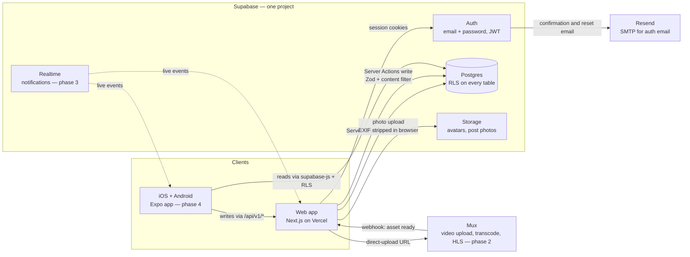

# 02 — Architecture

## Topology

**One rule shapes everything:** reads can go straight to Postgres, because
row-level security (RLS) decides what each viewer may see. Writes go through
GANJALOKA's own server code (Server Actions now, `/api/v1` routes for mobile),
because that is where validation, the content filter and rate limits run.
The database adds its own backstops (triggers and RLS), so a client that skips
the app still can't break the core rules.

## Stack (versions verified 2026-10-19 with `npm view`)
| Layer | Choice | Version | Why |
|---|---|---|---|
| Web framework | Next.js App Router, TypeScript strict | 16.4.x | Server Components keep the JS bundle small, and Server Actions give a typed write path |
| UI | React, Tailwind CSS v4, Radix primitives in shadcn style | React 19.2 / Tailwind 4.3 | Accessible primitives with no runtime CSS cost |
| Database | Supabase Postgres + RLS | Postgres 17 | One database for the social graph, posts and moderation; RLS is the security boundary for every client |
| Auth | Supabase Auth via `@supabase/ssr` | ssr 0.12 / supabase-js 2.118 | Cookie sessions on web and JWT on mobile, from the same user table |
| Files | Supabase Storage (public buckets, per-user folders) | — | Same RLS model as the database, with a CDN in front |
| Video (phase 2) | Mux Video (direct uploads + webhooks + HLS) | @mux/mux-node 15.x | No FFmpeg servers to run; adaptive streaming works on iOS, Android and web |
| Email | Resend as Supabase Auth's SMTP | — | Deliverable confirmation and reset email |
| Mobile (phase 4) | Expo SDK 58 / React Native 0.88, expo-router, expo-video | 58.x | One codebase for iOS and Android; native HLS playback |
| Analytics | Vercel Analytics | — | Privacy-friendly page analytics with no extra script weight |
| Tests | Vitest (unit + DB integration), Playwright (browser) | Vitest 4.x / PW 1.6x | DB tests run against a real local Supabase |
| Hosting | Vercel | — | Zero-ops hosting for Next.js. Note: the Hobby plan is non-commercial, so use Pro once GANJALOKA makes money (verify current Vercel terms) |

## Why not the AI-Mode "Facebook clone" topology
| Their topology | Problem at our size | GANJALOKA's choice |
|---|---|---|
| Nginx + Go ingest + NestJS + RabbitMQ + FFmpeg workers | Six services to deploy, secure and wake up for at 3am | Next.js + Supabase + Mux, all managed |
| GraphQL gateway | Extra schema layer with no client that needs it | Typed Server Actions + PostgREST/RPC |
| Redis fan-out-on-write timelines from day 1 | Solves a problem that starts around millions of follows | Fan-out-on-read SQL with a covering index (see Scale path) |
| Multi-region Redis sharding | Huge cost and complexity, zero benefit at small scale | Single region next to the users (US East) |
| Hand-rolled JWT auth | Easy to get subtly wrong | Supabase Auth: rotation, refresh and email flows handled |

## Request lifecycles
**Read the home feed (web).** The browser requests `/home`. `proxy.ts` refreshes
the session cookie and enforces the 21+ cookie. The Server Component calls the
RPC `home_feed(cursor)` as the signed-in user, so RLS applies. Postgres walks
`posts(author_id, created_at desc, id desc)` for the people you follow and
returns 20 rows plus authors and repost originals. The HTML streams to the browser.

**Create a post.** The client strips photo metadata (canvas re-encode to WebP)
and uploads to `post-media/<uid>/<uuid>.webp`. It then calls the Server Action
`createPost`, which runs Zod validation, the content filter (sales and slurs),
and an insert as the user. DB triggers then:
- check rate limits, suspensions and blocks
- confirm the media paths belong to the author
- bump counters

The page revalidates.

**Video (phase 2).** The client asks `/api/video/upload` for a Mux direct-upload
URL, and the server creates the upload with `passthrough = <video row id>`. The
client uploads straight to Mux. Mux calls `/api/mux/webhook`, and the server
verifies the signature, then stores `playback_id` and marks the video ready.
Players stream `https://stream.mux.com/<playback_id>.m3u8`.

## Security model
- **RLS on every table**, policies written with `(select auth.uid())` so the
  check runs once per query, not once per row.
- **Column-level grants.** Members can update only `display_name`, `bio` and
  `avatar_path` on their profile, never `role`, counters or `suspended_at`.
- **Security-definer functions** use `set search_path = ''` and check
  permissions themselves.
- **Secrets.** `SUPABASE_SECRET_KEY` and `MUX_*` live only on the server, in
  `.env.local` and Vercel env vars, never as `NEXT_PUBLIC_`.
- **All input is validated with Zod** at the server boundary. The DB repeats the
  critical constraints with CHECKs and triggers.
- **Security headers.** CSP, `X-Content-Type-Options`, `Referrer-Policy` and
  `Permissions-Policy` are set in `next.config.ts`.

## Scale path (change things only when a metric says so)
| Signal | Then do |
|---|---|
| p95 `home_feed` > 300 ms, or members following > 2,000 accounts on average | Add a `timelines` table filled by fan-out-on-write for accounts under 10k followers; merge celebrity posts on read (the hybrid model) |
| DB CPU > 70% sustained | Upgrade the Supabase compute tier, then add a read replica for feed RPCs |
| Hot counters cause lock contention | Move like and view counters to batched increments (Postgres queue, or Upstash Redis) |
| Search needed (phase 3) | Postgres full-text search with a GIN index; switch to Typesense only past ~5M posts |
| Video bills climb | Compare Mux with Cloudflare Stream ($5 per 1k minutes stored, $1 per 1k delivered as of 2026-10) |

## Cost at launch (verify current prices before budgeting)
| Service | Plan | Approx. monthly |
|---|---|---|
| Supabase | Free → Pro (8 GB DB and 100k MAU included per third-party summaries; check supabase.com/pricing) | $0 → $25 |
| Vercel | Hobby (non-commercial) → Pro | $0 → $20 per seat |
| Mux (phase 2) | Pay as you go: 100k delivered minutes free per month; storage about $0.0024 per minute per month at 720p | Usage-based |
| Resend | Free tier, then paid | $0 → $20 |
