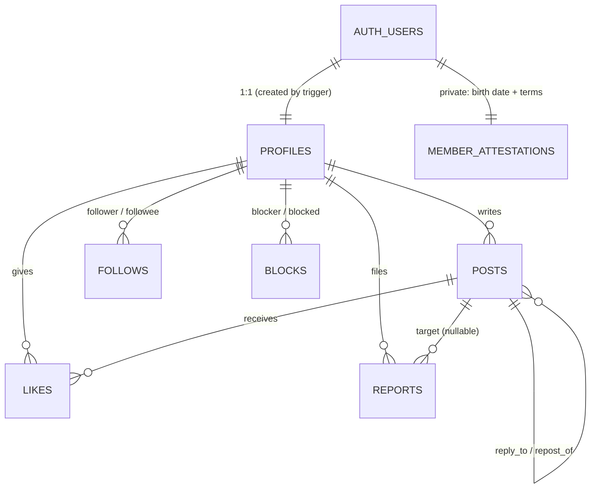

# 03 — Data Model

**Source of truth:** `supabase/migrations/20261019000100_social_core.sql`.
This page explains the migration. If they disagree, the migration wins: fix this doc.

## Entity map


## Tables
| Table | Key columns | Notes |
|---|---|---|
| `profiles` | `id` (= auth user id), `username` (unique, `^[a-z0-9_]{3,20}$`), `display_name` (1–50), `bio` (≤160), `avatar_path` (must start with `<id>/`), `role` (`member` · `moderator` · `admin`), `suspended_at`, `followers_count`, `following_count`, `posts_count` | Created only by the sign-up trigger. Members may update only `display_name`, `bio` and `avatar_path` (column grants) |
| `private.member_attestations` | `user_id`, `birth_date`, `terms_version`, `accepted_at` | Not exposed through the API and never placed in a JWT. Evidence of the 21+ check |
| `posts` | `id`, `author_id`, `kind` (`post` · `reply` · `repost`), `body` (≤500), `media` (JSON array, ≤4), `reply_to_id`, `repost_of_id`, `like_count`, `reply_count`, `repost_count`, `removed_at`, `created_at` | `kind` is fixed at insert, so a reply stays a reply even if its parent is deleted (parent link goes NULL). Members can't update posts (no edit in v1) |
| `likes` | PK (`member_id`, `post_id`) | Reposts can't be liked; you like the original |
| `follows` | PK (`follower_id`, `followee_id`), no self-follow | Indexed both ways |
| `blocks` | PK (`blocker_id`, `blocked_id`), no self-block | Visible only to the blocker. Blocking deletes follows in both directions |
| `reports` | `id`, `reporter_id`, `target_type` (`post` · `profile`), `post_id` / `profile_id` (nullable), `target_snapshot`, `reason`, `details` (≤500), `status` (`open` · `actioned` · `dismissed`), `resolution`, `resolved_by`, `resolved_at` | The snapshot keeps evidence even if the target is deleted. One open report per reporter per target |

### `posts.media` element
```json
{ "path": "<author uuid>/<uuid>.webp", "w": 1600, "h": 1200, "alt": "Purple phenotype, week 7" }
```
The DB trigger rejects any element whose `path` is outside the author's folder,
whose width or height is outside 1–8192, or whose alt text is over 300 characters.

## Triggers (the database's own guarantees)
| Trigger | Enforces |
|---|---|
| `auth.users` before insert → `handle_new_user` | Born on or before today minus 21 years (`GL_UNDER_21`), terms version present, username valid, not reserved and free. Creates the profile and attestation, and strips the birth date from metadata |
| `auth.users` before update → `scrub_user_metadata` | Birth date and terms keys never persist in user metadata (GoTrue rewrites metadata after insert) |
| `posts` before insert | Author not suspended; at most 8 posts per minute; resolves `kind`; replies need a visible parent; reposting a repost points at the original; no block between author and target; media shape and ownership; server-owned columns reset |
| `posts` after insert/delete | `posts_count` (not for reposts), `reply_count` and `repost_count` |
| `likes` before insert | Not suspended; post exists, isn't removed and isn't a repost; no block |
| `likes` after insert/delete | `like_count` |
| `follows` before insert | Not suspended; no block |
| `follows` after insert/delete | `followers_count` and `following_count` |
| `blocks` after insert | Removes follows in both directions |
| `reports` before insert | At most 20 reports per hour; snapshot of the target; server-owned columns reset |

## RLS policies
| Table | Select | Insert | Update | Delete |
|---|---|---|---|---|
| profiles | everyone | — (trigger) | own row, 3 columns | — (account deletion via admin API) |
| posts | everyone, **except** removed posts (visible to author and moderators) and posts across a block in either direction | own (`author_id = auth.uid()`) | — | own |
| likes | everyone | as self | — | as self |
| follows | everyone | as self | — | as self |
| blocks | blocker only | as self | — | as self |
| reports | reporter + moderators | as self | — (via `moderate_report`) | — |
| storage `avatars`, `post-media` | public URLs; own folder via API | own folder (`<uid>/…`), not suspended | own folder | own folder |

## RPC functions
| Function | Kind | Purpose |
|---|---|---|
| `home_feed(p_before_at, p_before_id, p_limit)` | invoker | Own and followed members' posts and reposts, newest first, keyset pagination |
| `explore_feed(p_before_at, p_before_id, p_limit)` | invoker | Everyone's posts and reposts, newest first |
| `profile_feed(p_profile_id, p_before_at, p_before_id, p_limit)` | invoker | One member's posts and reposts |
| `thread_replies(p_post_id, p_after_at, p_after_id, p_limit)` | invoker | Direct replies, oldest first |
| `moderate_report(p_report_id, p_action, p_note)` | definer, moderators only | `dismiss` · `remove_post` · `suspend_member` · `remove_and_suspend`; resolves every open report on the same target |

Invoker functions run as the caller, so RLS (removed posts and blocks) applies.
`p_limit` is clamped to 1–50.

## Indexes that carry the hot paths
- `posts (author_id, created_at desc, id desc)`: home feed (per followee), profile feed, rate limit
- `posts (created_at desc, id desc) where kind <> 'reply' and removed_at is null`: explore
- `posts (reply_to_id, created_at, id)`: threads
- `follows (followee_id, follower_id)`, `blocks (blocked_id, blocker_id)`, `likes (post_id)`

## Error codes raised by the database
`GL_UNDER_21`, `GL_INVALID_BIRTH_DATE`, `GL_TERMS_REQUIRED`, `GL_INVALID_USERNAME`,
`GL_USERNAME_TAKEN`, `GL_SUSPENDED`, `GL_RATE_LIMITED`, `GL_POST_UNAVAILABLE`,
`GL_PROFILE_UNAVAILABLE`, `GL_BLOCKED`, `GL_INVALID_MEDIA`, `GL_FORBIDDEN`,
`GL_INVALID_ACTION`, `GL_NOT_FOUND`. Postgres unique violations (`23505`) mean
"already done" (already liked, followed, reposted or reported).
The app maps every code to a human sentence in `src/lib/errors.ts`.

## Operations
- **Make a moderator:** in the SQL editor, run
  `update public.profiles set role = 'moderator' where username = '<name>';`
- **Apply migrations to the hosted project:** run `supabase link --project-ref <ref>`,
  then `supabase db push`.
- **Regenerate types after a schema change:** `pnpm db:types`.
