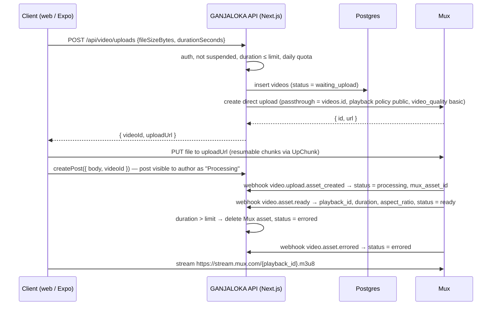

# 07 — Video Pipeline (Phase 2: the YouTube pillar)

## Decision
**Mux Video** handles ingest, transcoding to adaptive HLS, thumbnails and the CDN.
**Cloudflare Stream** is the documented alternative if costs or terms change.

Why managed instead of FFmpeg workers: transcoding fleets, storage lifecycle,
HLS packaging, CDN invalidation and device quirks are a full-time job. Mux turns
it into two API calls and a webhook. GANJALOKA keeps the important parts (who
owns which video, who can see it, moderation) in its own Postgres.

| | Mux | Cloudflare Stream |
|---|---|---|
| Ingest / encoding | Direct uploads; "basic" quality has no encoding fee | Direct creator uploads; encoding included |
| Storage | ≈ $0.0024 per minute per month at 720p (2026-10, **VERIFY**) | $5 per 1,000 minutes (2026-10, **VERIFY**) |
| Delivery | 100k minutes free per month, then ≈ $0.0008 per minute (**VERIFY**) | $1 per 1,000 minutes |
| Thumbnails / GIF previews | `image.mux.com/{playback_id}/thumbnail.webp?time=1` | Yes |
| SDKs | `@mux/mux-node`, `@mux/mux-player-react`, `@mux/mux-uploader-react` | REST + Stream Player |

## Flow


### Webhook handler `/api/mux/webhook`
- Verify the `mux-signature` header with `MUX_WEBHOOK_SECRET` (the SDK has a
  helper, `mux.webhooks.unwrap(rawBody, headers, secret)`). Reject anything that
  fails, and read the **raw** body.
- Look up the row by `passthrough` (our `videos.id`), never by client input.
- Process idempotently: the same event may arrive twice. Update only on forward
  status transitions (`waiting_upload → processing → ready`).
- Respond 200 quickly. Do no heavy work inline.

## Data model (phase 2 migration)
```sql
create table public.videos (
  id               uuid primary key default gen_random_uuid(),
  owner_id         uuid not null references public.profiles (id) on delete cascade,
  status           text not null default 'waiting_upload'
                   check (status in ('waiting_upload','processing','ready','errored','removed')),
  mux_upload_id    text unique,
  mux_asset_id     text unique,
  playback_id      text,
  duration_seconds numeric,
  aspect_ratio     text,
  view_count       bigint not null default 0,
  created_at       timestamptz not null default now(),
  ready_at         timestamptz
);
alter table public.posts add column video_id uuid unique references public.videos (id) on delete set null;
```
- **RLS:** select is open when `status = 'ready'`, and always open to the owner
  and moderators. Writes happen only from the server (service role, in the
  webhook and upload routes).
- **Post visibility:** a post whose video isn't `ready` is visible only to its
  author (extend the posts select policy).
- **Views:** RPC `record_view(video_id)`, de-duplicated per member per video per
  day in a `video_views` table, with `view_count` bumped by trigger. Mux Data is
  optional for quality-of-experience metrics.

## Limits (v1)
| Limit | Value |
|---|---|
| Max duration | 10 minutes (enforced client-side and in the `asset.ready` webhook) |
| Max uploads per member per day | 10 |
| Max file size | 2 GB |
| Formats | Whatever Mux ingests (MP4, MOV and most phone formats) |

## Players
- **Web:** `@mux/mux-player-react`, lazy-loaded with `next/dynamic` and a poster
  image (the thumbnail URL) so it doesn't hurt LCP.
- **Mobile:** `expo-video` with the HLS URL. Autoplay muted in the clip feed,
  pause when off-screen.
- **Two surfaces:** a watch page `/v/[id]` (YouTube-style, with title, replies
  and related clips) and a vertical clip feed `/clips` (short-video style).

## Moderation for video
- Reports work the same as for posts (`target_type = 'post'`).
- `moderate_report → remove_post` also sets `videos.status = 'removed'` and calls
  Mux to delete the asset (the evidence copy is kept per section 3 of
  `06-trust-safety-compliance.md`).
- **Before launch:** proactive CSAM hash matching on video thumbnails and frames
  (vendor integration). **This is a blocker for phase 2 launch.**

## Env vars (server only)
`MUX_TOKEN_ID`, `MUX_TOKEN_SECRET`, `MUX_WEBHOOK_SECRET`. Get them at
dashboard.mux.com → Settings → Access Tokens / Webhooks.
